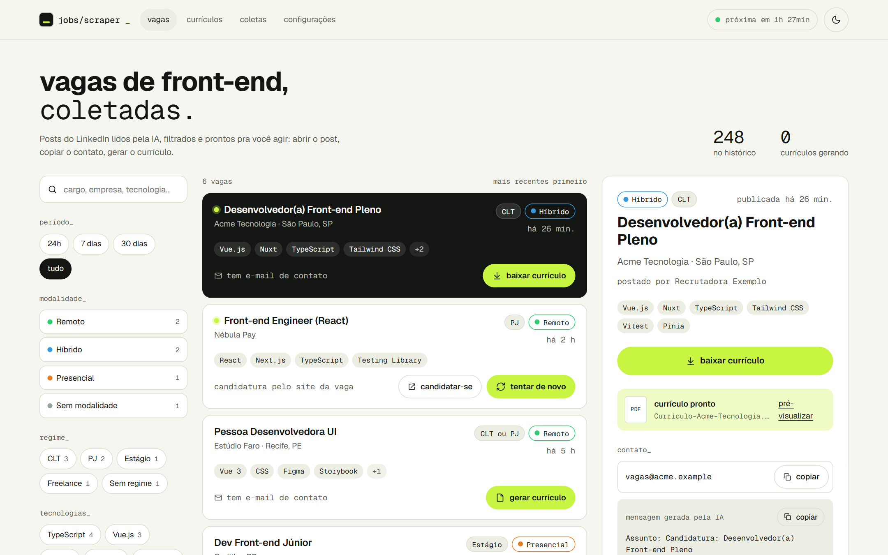
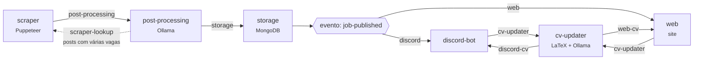

# Jobs Scraper 🚀💼

Coleta posts de vagas no LinkedIn, estrutura cada um com IA local (Ollama) e publica as vagas num canal do Discord e num site próprio. Em qualquer vaga, gera um currículo em PDF ajustado para ela.



## 📑 Sumário

- [🗺️ Como funciona](#como-funciona)
- [🧩 Serviços](#servicos)
- [🛠️ Tecnologias](#tecnologias)
- [🏃‍♂️ Como rodar](#como-rodar)
- [🧰 Scripts](#scripts)
- [⚠️ Observações](#observacoes)
- [🤝 Contribuindo](#contribuindo)

<a id="como-funciona"></a>

## 🗺️ Como funciona

Os serviços conversam por filas do RabbitMQ; cada fila tem o nome do serviço que a consome.



<a id="servicos"></a>

## 🧩 Serviços

Cada serviço tem um README com os detalhes.

| Serviço | O que faz |
| --- | --- |
| [🕷️ scraper](src/services/scraper/README.md) | busca os posts no LinkedIn pelos termos configurados, cuida do login e abre os links dos posts com várias vagas |
| [🧠 post-processing](src/services/post-processing/README.md) | ignora posts já vistos, filtra por idioma e palavras-chave e extrai a vaga com o Ollama |
| [🗄️ storage](src/services/storage/README.md) | salva a vaga no MongoDB, sem duplicar, e anuncia no evento `job-published` |
| [🤖 discord-bot](src/services/discord-bot/README.md) | publica um card por vaga (canal de texto ou fórum) e entrega o currículo |
| [🌐 web](src/services/web/README.md) | o site em http://localhost:3000: vagas com filtros, currículos, coletas e configurações |
| [📄 cv-updater](src/services/cv-updater/README.md) | gera o currículo em PDF ajustado à vaga, a partir do seu `.tex`, e a mensagem de candidatura |
| [🧩 shared](src/shared/README.md) | código comum: filas (retry e DLQ), banco, contratos e configurações editáveis em tempo de execução |

<a id="tecnologias"></a>

## 🛠️ Tecnologias

- **Bun** + **TypeScript** em todos os serviços
- **Puppeteer** (com o plugin stealth) para o scraping
- **RabbitMQ** para as filas
- **MongoDB** + **Mongoose** para o armazenamento
- **Ollama** para a IA local
- **Discord.js** para o bot
- **React 19** no site, empacotado pelo próprio Bun
- **Tectonic** (LaTeX) para o currículo
- **Zod** para validar configurações e mensagens, **Pino** para os logs
- **Biome** (lint), **Prettier** (formatação) e `bun test`
- **Docker Compose** para a infraestrutura e os serviços

<a id="como-rodar"></a>

## 🏃‍♂️ Como rodar

Pré-requisitos: [Bun](https://bun.sh) 1.4+ e Docker.

```bash
git clone https://github.com/P0sseid0n/jobs-scraper.git
cd jobs-scraper
bun install
cp .env.example .env      # preencha LinkedIn, Discord e troque as senhas
docker compose up -d      # RabbitMQ, MongoDB, mongo-express e Ollama
bun dev                   # todos os serviços, com hot reload
```

- **GPU NVIDIA:** descomente `COMPOSE_FILE` no `.env`. Sem isso, o Ollama roda na CPU e consome muita RAM. Para conferir, `docker compose exec ollama ollama ps` deve mostrar `100% GPU`.
- **Primeira subida:** o `ollama-init` baixa o modelo de `OLLAMA_MODEL` (padrão `gemma3:4b`). Acompanhe com `docker compose logs -f ollama-init`.
- **Currículo:** para gerar currículos, coloque o seu em `data/cv/cv.tex` e configure o Tectonic, como no [README do cv-updater](src/services/cv-updater/README.md#configuração).
- **Configurações:** termos de busca, filtros e intervalo são editados pelo site; o `.env` só preenche os valores iniciais (veja [shared](src/shared/README.md#configurações-em-tempo-de-execução)).
- **Tudo em containers:** `docker compose --profile app up -d --build`.
- **Coleta única ou periódica:** por padrão o scraper coleta uma vez e encerra. Com `SCRAPER_INTERVAL_MINUTES` (ex.: `180`), ele fica rodando e coleta periodicamente.

Painéis, todos só em `127.0.0.1`:

- RabbitMQ: http://localhost:15672
- mongo-express: http://localhost:8081

<a id="scripts"></a>

## 🧰 Scripts

| Script                                        | Descrição                                                          |
| --------------------------------------------- | ------------------------------------------------------------------ |
| `bun dev`                                     | Todos os serviços com `--watch`                                    |
| `bun dev:scraped`                             | Todos menos o scraper                                              |
| `bun dev:<serviço>` / `bun start:<serviço>`   | Um serviço (`scraper`, `processing`, `storage`, `bot`, `cv`, `web`) |
| `bun scraper:run`                             | Pede uma coleta imediata                                           |
| `bun scraper:verify <código>`                 | Envia o código de verificação do login                             |
| `bun db:migrate-jobs`                         | Atualiza as vagas salvas para o formato atual                      |
| `bun run typecheck` / `lint` / `format:check` | Tipos, Biome e Prettier                                            |
| `bun test`                                    | Testes                                                             |

O CI roda `typecheck`, `lint`, `format:check` e `test` em todo push e PR.

<a id="observacoes"></a>

## ⚠️ Observações

- **Nunca** suba o `.env` ou a pasta `data/`: ela tem o seu currículo e a sessão do LinkedIn.
- O Mongo e o RabbitMQ só criam o usuário quando o volume é criado. Para trocar as credenciais, recrie os volumes com `docker compose down -v`, o que **apaga os dados**.
- Fazer scraping do LinkedIn vai contra os Termos de Uso e pode bloquear a conta. Use uma conta dedicada, poucos posts e termos por coleta, e espace as coletas.
- Os logs em `info` registram só IDs e metadados. O conteúdo dos posts aparece só com `LOG_LEVEL=debug`.

<a id="contribuindo"></a>

## 🤝 Contribuindo

O padrão das issues, branches e commits está no [CONTRIBUTING.md](CONTRIBUTING.md). Licença [MIT](LICENSE).
