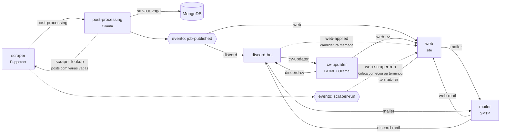

# Jobs Scraper 🚀💼

Coleta posts de vagas no LinkedIn, estrutura cada um com IA local (Ollama) e publica as vagas num canal do Discord e num site próprio. Em qualquer vaga, gera um currículo em PDF ajustado para ela.

Serve para qualquer área: enfermagem, marketing, direito, vendas, engenharia, tecnologia... Você informa a sua área e o cargo que procura, e o site sugere os termos de busca e monta o currículo base com você.


## 📑 Sumário

- [🙋 Para quem não é dev](#para-quem-nao-e-dev)
- [🗺️ Como funciona](#como-funciona)
- [🧩 Serviços](#servicos)
- [🛠️ Tecnologias](#tecnologias)
- [🏃‍♂️ Como rodar (para devs)](#como-rodar)
- [🧰 Scripts](#scripts)
- [⚠️ Observações](#observacoes)
- [🤝 Contribuindo](#contribuindo)

<a id="para-quem-nao-e-dev"></a>

## 🙋 Para quem não é dev

Tudo roda no seu computador, dentro do **Docker**: o banco, a IA, o site e o robô que lê o LinkedIn. Você instala um programa, baixa o projeto, roda um comando e faz o resto pelo site.

Você vai precisar de:

- um computador com Windows 10/11, macOS ou Linux, com pelo menos **8 GB de RAM** (16 GB é mais confortável) e **25 GB livres** no disco (a instalação ocupa uns 17 GB, quase tudo da IA);
- uma conta no LinkedIn. De preferência, uma criada só para isso: veja as [observações](#observacoes).

### 1. Instale o Docker Desktop

- **Windows:** [Docker Desktop para Windows](https://docs.docker.com/desktop/setup/install/windows-install/). Durante a instalação, deixe marcado "Use WSL 2", e reinicie o computador se ele pedir.
- **macOS:** [Docker Desktop para Mac](https://docs.docker.com/desktop/setup/install/mac-install/). Escolha a versão do seu processador (Apple Silicon, nos Macs M1 em diante, ou Intel).
- **Linux:** [Docker Desktop para Linux](https://docs.docker.com/desktop/setup/install/linux/) ou, se preferir, o [Docker Engine](https://docs.docker.com/engine/install/).

Abra o Docker Desktop e espere ele dizer que está rodando ("Engine running"). Ele precisa estar aberto sempre que você for usar o projeto.

### 2. Baixe o projeto

[Baixe o ZIP](https://github.com/P0sseid0n/jobs-scraper/archive/refs/heads/main.zip) e extraia numa pasta fácil de achar, como a Área de Trabalho. A pasta extraída se chama `jobs-scraper-main`.

Se você tem o [Git](https://git-scm.com/downloads), pode clonar em vez de baixar o ZIP, o que facilita atualizar depois: `git clone https://github.com/P0sseid0n/jobs-scraper.git`.

### 3. Abra um terminal na pasta do projeto

- **Windows:** abra a pasta `jobs-scraper-main` no Explorador de Arquivos, clique com o botão direito num espaço vazio e escolha **Abrir no Terminal**.
- **macOS:** abra o app **Terminal**, digite `cd ` (com o espaço), arraste a pasta para a janela e aperte Enter.
- **Linux:** clique com o botão direito dentro da pasta e escolha **Abrir no terminal**.

### 4. Crie o arquivo de configuração

Copie o `.env.example` para `.env`. Não precisa abrir nem editar: o resto é feito pelo site.

- **Windows:** `Copy-Item .env.example .env`
- **macOS e Linux:** `cp .env.example .env`

### 5. Suba tudo

```bash
docker compose --profile app up -d --build
```

Na primeira vez, o Docker baixa as imagens e o modelo de IA (uns 10 GB no total) e leva de 10 a 30 minutos, conforme a internet. Nas próximas, sobe em segundos. Espere o comando terminar antes de abrir o site: ele só termina depois que o modelo de IA foi baixado, e sem ele o site não consegue sugerir os termos de busca.

### 6. Abra o site e siga o passo a passo

Abra **http://localhost:3000** no navegador. Na primeira vez, o site abre o passo a passo de configuração:

1. **Área:** a sua área, o cargo que você procura e a senioridade. A IA sugere os termos de busca e as palavras-chave, e você revisa.
2. **LinkedIn:** o e-mail e a senha da conta. Ao salvar, o site testa o login. Se o LinkedIn pedir uma confirmação (aprovar no app do celular, um código ou um QR code), abre uma janela no site, em qualquer tela, para você resolver em até 3 minutos.
3. **Currículo:** preencha o formulário (contato, experiência, formação, habilidades...) e veja a prévia do PDF. Quem já tem um currículo em LaTeX pode enviar o `.tex`.
4. **Discord e GitHub:** opcionais, pode pular.
5. **E-mail:** opcional. Com a sua conta de e-mail (SMTP, como o Gmail com uma senha de app), o botão **enviar candidatura** manda a mensagem e o currículo direto para o recrutador, depois de você confirmar.
6. **Revisão:** confira e clique em **fazer a primeira coleta**.

As primeiras vagas aparecem no site em alguns minutos. Em qualquer vaga, **gerar currículo** cria um PDF ajustado para ela. Tudo o que você configurou fica editável em **Configurações**.

### No dia a dia

Rode os comandos no terminal, dentro da pasta do projeto, com o Docker Desktop aberto.

- **Coletas:** enquanto o projeto está ligado, ele coleta sozinho a cada 4 horas (o intervalo muda em Configurações). Para coletar na hora, use **coletar agora**, na tela Coletas.
- **Desligar:** `docker compose --profile app stop`. As vagas, os currículos e as configurações ficam guardados.
- **Ligar de novo:** `docker compose --profile app up -d`.
- **Atualizar:** baixe o ZIP de novo e extraia na mesma pasta, por cima (ou `git pull`, se clonou), e rode `docker compose --profile app up -d --build`.
- **Algo deu errado:** `docker compose --profile app ps` mostra o que está rodando, e `docker compose --profile app logs -f web` (ou `scraper`, `cv-updater`...) mostra as mensagens de um serviço.

<a id="como-funciona"></a>

## 🗺️ Como funciona

Os serviços conversam por filas do RabbitMQ; cada fila tem o nome do serviço que a consome.



<a id="servicos"></a>

## 🧩 Serviços

Cada serviço tem um README com os detalhes.

| Serviço | O que faz |
| --- | --- |
| [🕷️ scraper](src/services/scraper/README.md) | busca os posts no LinkedIn pelos termos configurados, cuida do login e abre os links dos posts com várias vagas |
| [🧠 post-processing](src/services/post-processing/README.md) | ignora posts já vistos, filtra por idioma e palavras-chave, extrai a vaga com o Ollama, salva no MongoDB sem duplicar e anuncia no evento `job-published` |
| [🤖 discord-bot](src/services/discord-bot/README.md) | publica um card por vaga (canal de texto ou fórum) e entrega o currículo |
| [🌐 web](src/services/web/README.md) | o site em http://localhost:3000: vagas com filtros, currículos, coletas e configurações |
| [📄 cv-updater](src/services/cv-updater/README.md) | gera o currículo em PDF ajustado à vaga, a partir do seu `.tex`, e a mensagem de candidatura |
| [✉️ mailer](src/services/mailer/README.md) | envia a candidatura por e-mail (SMTP), com o currículo anexado, depois da confirmação no site ou no Discord |
| [🧩 shared](src/shared/README.md) | código comum: filas (retry e DLQ), banco, contratos e configurações editáveis em tempo de execução |

<a id="tecnologias"></a>

## 🛠️ Tecnologias

- **Bun** + **TypeScript** em todos os serviços
- **Puppeteer** (com o plugin stealth) para o scraping
- **RabbitMQ** para as filas
- **MongoDB** + **Mongoose** para o armazenamento
- **Ollama** para a IA local
- **Discord.js** para o bot
- **React 19** no site, empacotado pelo próprio Bun
- **Tectonic** (LaTeX) para o currículo
- **Zod** para validar configurações e mensagens, **Pino** para os logs
- **Biome** (lint), **Prettier** (formatação) e `bun test`
- **Docker Compose** para a infraestrutura e os serviços

<a id="como-rodar"></a>

## 🏃‍♂️ Como rodar (para devs)

Pré-requisitos: [Bun](https://bun.sh) 1.4+ e Docker.

```bash
git clone https://github.com/P0sseid0n/jobs-scraper.git
cd jobs-scraper
bun install
cp .env.example .env      # troque as senhas; as contas (LinkedIn, Discord, GitHub) podem ir aqui ou pelo site
docker compose up -d      # RabbitMQ, MongoDB, mongo-express e Ollama
bun dev                   # todos os serviços, com hot reload
```

- **GPU NVIDIA:** descomente `COMPOSE_FILE` no `.env`. Sem isso, o Ollama roda na CPU e consome muita RAM. Para conferir, `docker compose exec ollama ollama ps` deve mostrar `100% GPU`.
- **Primeira subida:** o `ollama-init` baixa o modelo de `OLLAMA_MODEL` (padrão `gemma3:4b`). Acompanhe com `docker compose logs -f ollama-init`.
- **Currículo:** para gerar currículos, envie o seu `.tex` pelo site (Meus currículos › currículo base) ou coloque-o em `data/cv/cv.tex`, e configure o Tectonic, como no [README do cv-updater](src/services/cv-updater/README.md#configuração).
- **Configurações:** termos de busca, filtros e intervalo são editados pelo site; o `.env` só preenche os valores iniciais (veja [shared](src/shared/README.md#configurações-em-tempo-de-execução)).
- **Contas:** as credenciais do LinkedIn, do Discord, do GitHub e do e-mail (SMTP) podem ser informadas em Configurações › Contas, sem editar o `.env`; o que for salvo lá vale no lugar do `.env` (veja [shared](src/shared/README.md#credenciais)). Sem elas, os serviços sobem mesmo assim e esperam: o scraper não coleta, as vagas não vão para o Discord e o site diz o que falta.
- **Tudo em containers:** `docker compose --profile app up -d --build`.
- **Instâncias isoladas:** `bun instance <nome>` sobe a aplicação inteira no Docker num projeto separado, do zero (banco, filas, sessão do LinkedIn, IA e currículo próprios, em `data/instancias/<nome>/`), para testar o onboarding sem mexer na sua instalação. Com o nome de uma que já existe, liga ela de novo com o que foi configurado. `--importar-env` usa uma cópia do seu `.env`; `--parar`, `--apagar` e `bun instance --listar` completam. Roda uma por vez: subir uma desliga as outras e a principal, que volta com `docker compose up -d`.
- **Coleta periódica ou única:** com o `.env.example`, o scraper fica rodando e coleta a cada `SCRAPER_INTERVAL_MINUTES` (240; depois, vale o intervalo editado pelo site). Com `SCRAPER_INTERVAL_MINUTES=0`, ele coleta uma vez e encerra.

Painéis, todos só em `127.0.0.1`:

- RabbitMQ: http://localhost:15672
- mongo-express: http://localhost:8081

<a id="scripts"></a>

## 🧰 Scripts

| Script                                        | Descrição                                                          |
| --------------------------------------------- | ------------------------------------------------------------------ |
| `bun dev`                                     | Todos os serviços com `--watch`                                    |
| `bun dev:scraped`                             | Todos menos o scraper                                              |
| `bun dev:<serviço>` / `bun start:<serviço>`   | Um serviço (`scraper`, `processing`, `bot`, `cv`, `mailer`, `web`)  |
| `bun scraper:run`                             | Pede uma coleta imediata                                           |
| `bun scraper:verify <código>`                 | Envia o código de verificação do login                             |
| `bun db:migrate-jobs`                         | Atualiza as vagas salvas para o formato atual                      |
| `bun routes`                                  | Gera a árvore de rotas do site (`routeTree.gen.ts`)                |
| `bun instance <nome>`                         | Cria ou liga uma instância isolada no Docker (veja acima)          |
| `bun eval:extraction`                         | Mede o acerto da IA por campo nas vagas corrigidas pelo site       |
| `bun eval:export-fixtures`                    | Exporta as correções, sem dados pessoais, como casos versionados   |
| `bun run typecheck` / `lint` / `format:check` | Tipos, Biome e Prettier                                            |
| `bun test`                                    | Testes                                                             |

O CI roda `typecheck`, `lint`, `format:check` e `test` em todo push e PR.

<a id="observacoes"></a>

## ⚠️ Observações

- **Nunca** suba o `.env` ou a pasta `data/`: ela tem o seu currículo e a sessão do LinkedIn.
- O Mongo e o RabbitMQ só criam o usuário quando o volume é criado. Para trocar as credenciais, recrie os volumes com `docker compose down -v`, o que **apaga os dados**.
- Fazer scraping do LinkedIn vai contra os Termos de Uso e pode bloquear a conta. Use uma conta dedicada, poucos posts e termos por coleta, e espace as coletas.
- Os logs em `info` registram só IDs e metadados. O conteúdo dos posts aparece só com `LOG_LEVEL=debug`.

<a id="contribuindo"></a>

## 🤝 Contribuindo

O padrão das issues, branches e commits está no [CONTRIBUTING.md](CONTRIBUTING.md). Licença [MIT](LICENSE).
