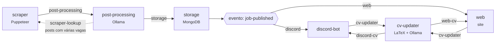

# Jobs Scraper 🚀💼

Coleta posts de vagas no LinkedIn, estrutura cada um com IA local (Ollama) e publica as vagas num canal do Discord e num site próprio. Em qualquer vaga, gera um currículo em PDF ajustado para ela.


## 📑 Sumário

- [🗺️ Como funciona](#como-funciona)
- [🌐 Site](#site)
- [📄 Currículo ajustado](#curriculo)
- [🛠️ Tecnologias](#tecnologias)
- [🏃‍♂️ Como rodar](#como-rodar)
- [⚙️ Configurações](#configuracoes)
- [🔐 Login no LinkedIn](#login)
- [🧰 Scripts](#scripts)
- [📁 Estrutura](#estrutura)
- [⚠️ Observações](#observacoes)
- [🤝 Contribuindo](#contribuindo)

<a id="como-funciona"></a>

## 🗺️ Como funciona

Os serviços conversam por filas do RabbitMQ; cada fila tem o nome do serviço que a consome.



1. **scraper:** busca posts no LinkedIn pelos termos configurados.
2. **post-processing:** ignora posts já vistos, descarta idiomas não aceitos e extrai a vaga com o Ollama. Posts que listam várias vagas são divididos por regra, e o scraper abre o link de cada uma.
3. **storage:** salva a vaga no MongoDB, sem duplicar, e publica o evento `job-published`.
4. **discord-bot** e **web:** cada canal liga a própria fila no evento e recebe todas as vagas. O bot publica um card por vaga, em canal de texto ou de fórum, com tags.
5. **cv-updater:** gera o currículo pedido por qualquer canal e devolve na fila de resposta do pedido.

Toda fila `X` tem uma `X.retry`, com backoff exponencial, e uma `X.dlq`, para as mensagens inválidas ou que falharam mais de `QUEUE_MAX_RETRIES` vezes.

<a id="site"></a>

## 🌐 Site

Abre em http://localhost:3000. Não tem login: a porta fica só em `127.0.0.1`.

- **Vagas:** busca e filtros por modalidade, regime, tecnologias, período, e-mail, idioma e confiança. As vagas novas chegam em tempo real.
- **Detalhe:** o post original, o e-mail para copiar e a mensagem de candidatura.
- **Currículos:** "gerar currículo" em qualquer vaga, com o progresso num indicador no canto. Os PDFs ficam em "Meus currículos".
- **Coletas:** coleta em andamento, próxima agendada, "coletar agora", pausa e histórico por termo.
- **Configurações:** termos de busca, limites, intervalo e filtros das vagas, valendo sem reiniciar.

É React 19 em TSX, empacotado pelo próprio Bun (`Bun.serve` com import de HTML), sem Vite.

<a id="curriculo"></a>

## 📄 Currículo ajustado

O cv-updater parte do seu próprio `.tex` e compila com o [Tectonic](https://tectonic-typesetting.github.io), então o PDF mantém o design original. A IA reescreve a apresentação, as tecnologias pedidas entram nas habilidades, e os projetos mais relevantes vêm do seu GitHub (`GITHUB_USERNAME`). A experiência é só reordenada. Em vagas com e-mail, vem junto uma mensagem de candidatura. Se o PDF passar de uma página, ele é simplificado até caber.

1. Coloque seu currículo em `data/cv/cv.tex`, no formato de `src/services/cv-updater/assets/cv.example.tex`.
2. Instale o [Tectonic](https://github.com/tectonic-typesetting/tectonic/releases) e aponte `TECTONIC_BIN` para ele. No Docker, ele já vem na imagem.
3. A fonte Nunito já vem em `src/services/cv-updater/assets/fonts/`. Para outra fonte, coloque os `.otf` nessa pasta.

<a id="tecnologias"></a>

## 🛠️ Tecnologias

- **Bun** + **TypeScript** em todos os serviços
- **Puppeteer** (com o plugin stealth) para o scraping
- **RabbitMQ** para as filas
- **MongoDB** + **Mongoose** para o armazenamento
- **Ollama** para a IA local
- **Discord.js** para o bot
- **React 19** no site, empacotado pelo próprio Bun
- **Tectonic** (LaTeX) para o currículo
- **Zod** para validar configurações e mensagens, **Pino** para os logs
- **Biome** (lint), **Prettier** (formatação) e `bun test`
- **Docker Compose** para a infraestrutura e os serviços

<a id="como-rodar"></a>

## 🏃‍♂️ Como rodar

Pré-requisitos: [Bun](https://bun.sh) 1.4+ e Docker.

```bash
git clone https://github.com/P0sseid0n/jobs-scraper.git
cd jobs-scraper
bun install
cp .env.example .env      # preencha LinkedIn, Discord e troque as senhas
docker compose up -d      # RabbitMQ, MongoDB, mongo-express e Ollama
bun dev                   # todos os serviços, com hot reload
```

- **GPU NVIDIA:** descomente `COMPOSE_FILE` no `.env`. Sem isso, o Ollama roda na CPU e consome muita RAM. Para conferir, `docker compose exec ollama ollama ps` deve mostrar `100% GPU`.
- **Primeira subida:** o `ollama-init` baixa o modelo de `OLLAMA_MODEL` (padrão `gemma3:4b`). Acompanhe com `docker compose logs -f ollama-init`.
- **Tudo em containers:** `docker compose --profile app up -d --build`.
- **Coleta única ou periódica:** por padrão o scraper coleta uma vez e encerra. Com `SCRAPER_INTERVAL_MINUTES` (ex.: `180`), ele fica rodando e coleta periodicamente.

Painéis, todos só em `127.0.0.1`:

- RabbitMQ: http://localhost:15672
- mongo-express: http://localhost:8081

<a id="configuracoes"></a>

## ⚙️ Configurações

Termos de busca, filtro de data, limites, intervalo, pausa, confiança mínima, idiomas e palavras-chave ficam na coleção `settings` do MongoDB e são editados pelo site. As variáveis do `.env` (`SEARCH_KEYWORDS`, `SCRAPER_MAX_POSTS`, `JOB_REQUIRED_KEYWORDS`…) só preenchem essa coleção na primeira execução. Para voltar a usar o `.env`, apague o documento da coleção. Todas as variáveis estão documentadas no `.env.example`.

- **Palavras-chave:** a vaga precisa citar no cargo ou nas tecnologias ao menos uma palavra obrigatória e nenhuma excluída. A comparação é por palavra inteira e ignora acentos, hífen e ".js".
- **Coletar agora:** `bun scraper:run` pede uma coleta imediata, mesmo com as coletas pausadas.

<a id="login"></a>

## 🔐 Login no LinkedIn

A sessão fica salva em `data/scraper/linkedin-cookies.json`, então o login só é refeito quando ela expira. Com `HEADLESS=auto` (padrão), o navegador roda sem janela. Se o LinkedIn pedir uma verificação:

- **QR code:** aparece no terminal para escanear com o app.
- **Código** (e-mail, SMS ou autenticador): envie de outro terminal com `bun scraper:verify 123456`.
- **Aprovação no app:** aprove no celular; o scraper espera até 3 minutos.
- **Captcha:** onde há tela, o scraper abre a janela para você resolver. No Docker, salva um print em `data/scraper/login-verification.png` e a coleta falha.

<a id="scripts"></a>

## 🧰 Scripts

| Script                                        | Descrição                                                          |
| --------------------------------------------- | ------------------------------------------------------------------ |
| `bun dev`                                     | Todos os serviços com `--watch`                                    |
| `bun dev:scraped`                             | Todos menos o scraper                                              |
| `bun dev:<serviço>` / `bun start:<serviço>`   | Um serviço (`scraper`, `processing`, `storage`, `bot`, `cv`, `web`) |
| `bun scraper:run`                             | Pede uma coleta imediata                                           |
| `bun scraper:verify <código>`                 | Envia o código de verificação do login                             |
| `bun db:migrate-jobs`                         | Atualiza as vagas salvas para o formato atual                      |
| `bun run typecheck` / `lint` / `format:check` | Tipos, Biome e Prettier                                            |
| `bun test`                                    | Testes                                                             |

O CI roda `typecheck`, `lint`, `format:check` e `test` em todo push e PR.

<a id="estrutura"></a>

## 📁 Estrutura

```
src/
  shared/             # código comum (@shared/<módulo>): filas, banco, contratos, configurações, logs
  services/
    scraper/          # coleta no LinkedIn (Puppeteer)
    post-processing/  # extração da vaga com o Ollama
    storage/          # MongoDB e evento job-published
    discord-bot/      # cards das vagas e entrega do currículo
    cv-updater/       # currículo ajustado (LaTeX)
    web/              # site: API e SSE (server/) e aplicação React (client/)
data/                 # dados de execução, fora do git: currículo, PDFs, cache e sessão do LinkedIn
```

Cada serviço tem um `index.ts` (ponto de entrada) e, quando precisa, um `config.ts` com as variáveis próprias. Os testes ficam ao lado do arquivo testado (`*.test.ts`).

<a id="observacoes"></a>

## ⚠️ Observações

- **Nunca** suba o `.env` ou a pasta `data/`: ela tem o seu currículo e a sessão do LinkedIn.
- O Mongo e o RabbitMQ só criam o usuário quando o volume é criado. Para trocar as credenciais, recrie os volumes com `docker compose down -v`, o que **apaga os dados**.
- Fazer scraping do LinkedIn vai contra os Termos de Uso e pode bloquear a conta. Use uma conta dedicada, poucos posts e termos por coleta, e espace as coletas.
- Os logs em `info` registram só IDs e metadados. O conteúdo dos posts aparece só com `LOG_LEVEL=debug`.

<a id="contribuindo"></a>

## 🤝 Contribuindo

O padrão das issues, branches e commits está no [CONTRIBUTING.md](CONTRIBUTING.md). Licença [MIT](LICENSE).
